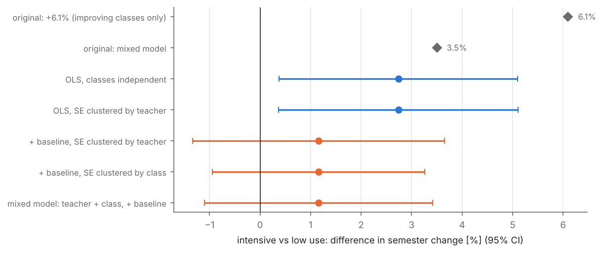
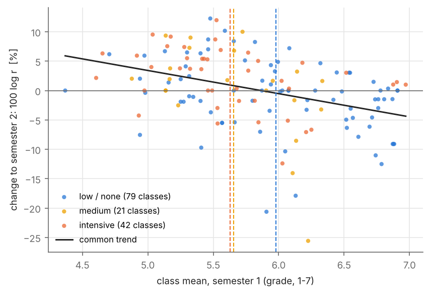

# Did a teacher platform raise grades? A re-analysis of the ClassRoomMate pilot

In the second semester of 2018, the learning-management platform **ClassRoomMate** was piloted in a public school
in Santiago, Chile: 51 teachers, 27 classes from 4th grade to the last year of secondary school. Each teacher,
together with the students of each class, chose how intensively to use it. The original evaluation compared the
change of the class mean between the two semesters across usage levels and reported that intensive use raised
performance by 3.5-6.1 % and the probability of improvement to 75 %.

This repository rebuilds that analysis from the school's grade books and asks what survives. The report is
[`report/report.pdf`](report/report.pdf).

## Findings

| | |
|---|---|
| **Replication** | The original numbers replicate exactly from the original work sheet (logistic coefficient 1.040, mixed-model coefficient 0.035). |
| **Headline figures** | The "+6.1 %" is the mean increase over the *improving* intensive-use classes only (4.3 % for low use). The "75 % probability of improvement" counts unchanged classes (r = 1, 12 % of all classes after rounding) as improved; with r > 1 it is 62 % vs 39 %. |
| **Regression to the mean** | Classes that chose intensive use started 0.35 grade points lower, and every grade point lower at the start goes with +4 % more change. |
| **Adjusted association** | Accounting for the starting level and the clustering of classes within teachers: **+1.2 % (95 % CI -1.3 % to +3.6 %)**, compatible with no effect and with a small positive one. Medium use: no association. |
| **Power** | With 13-15 intensive-use teachers, only differences of about 4 % were detectable. |
| **Design** | Usage was self-selected and the outcome is the grades given by the same teachers: the pilot supports an association at most, not an impact. |





## Data and privacy

The school's grade books contain the names and grades of students, most of them minors; the staff list contains the
teachers' names. **No data are included in this repository**, and the school is not named. The code reads the
private files and writes only class means with anonymous teacher identifiers to `data/private/`, which is
git-ignored. The tests run on synthetic grade books that reproduce the layout of the real exports.

## Repository

```
src/crmpilot/
  gradebook.py     parser of the grade-book exports -> class means per course x subject (nothing personal leaves it)
  sources.py       staff list -> anonymous teacher ids; work-sheet rows -> their class (value matching + order)
  replication.py   the original analysis, line by line, with and without the summary-row error
  analysis.py      re-analysis: baseline, clustering, mixed model, teacher-level permutation test, power
scripts/           build_dataset, replicate_original, reanalysis, make_figures
results/           aggregate results (CSV / JSON)
figures/           PNG (README) + PDF (report)
report/            LaTeX source of the report (make)
tests/             pytest, synthetic data only
```

## Reproduce (with access to the school's files)

```bash
pip install -r requirements.txt
pytest -q

python scripts/build_dataset.py <grade-book folder> <staff list .docx> <original work sheet .xlsx>
cp <original work sheet .xlsx> data/private/worksheet_original.xlsx
python scripts/replicate_original.py
python scripts/reanalysis.py
python scripts/make_figures.py
cd report && make
```

Disclosure: the author collaborated with ClassRoomMate during the pilot.
